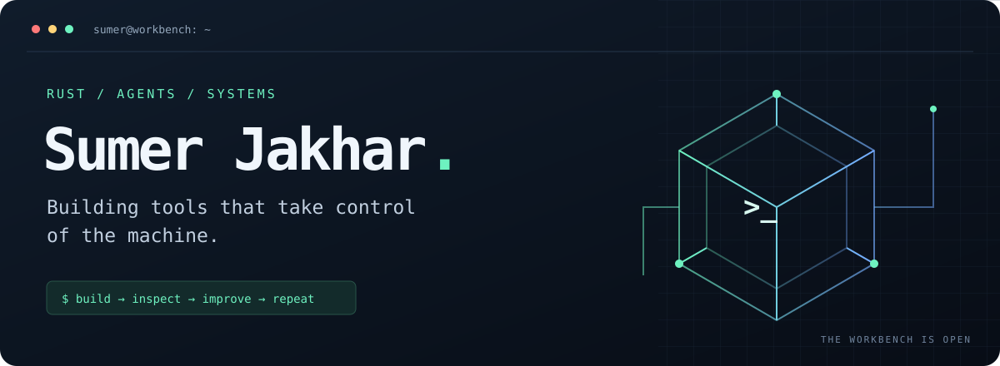

  

  <a href="#selected-builds">Selected builds</a> &nbsp; / &nbsp;
  <a href="#toolkit">Toolkit</a> &nbsp; / &nbsp;
  <a href="https://github.com/sumerchoudhary78?tab=repositories">All repositories</a>

I’m **Sumer**, a software developer from India. I build tools for AI agents, Linux desktops, and Android devices — from deterministic game worlds to watchdogs that keep a connection alive.

My favorite projects make a machine easier to control, inspect, or recover when something goes wrong.

## Selected builds

<table>
<tr>
<td width="50%" valign="top">

### 01 / AgentForge
**Game worlds built for agents.**

A headless, deterministic engine with grid dungeons and rigid-body physics. Agents create scenes, play, diagnose failures, and verify replays through JSON Lines and MCP tools.

`Rust` · `Simulation` · `MCP`

[Explore the engine →](https://github.com/sumerchoudhary78/aigameengine)

</td>
<td width="50%" valign="top">

### 02 / HyprPilot
**Give agents the keys to the desktop.**

A typed Rust client, daemon, and CLI for Hyprland. Desktop control designed to be driven by AI agents.

`Rust` · `Linux` · `Hyprland`

[Explore desktop control →](https://github.com/sumerchoudhary78/HyprPilot)

</td>
</tr>
<tr>
<td width="50%" valign="top">

### 03 / ADB Watchdog
**Keep wireless debugging within reach.**

An on-device watchdog that keeps Android wireless ADB enabled, using an accessibility service with a secure-settings fallback. Tested on Realme Narzo 50 / ColorOS.

`Kotlin` · `Android` · `ADB`

[Explore the watchdog →](https://github.com/sumerchoudhary78/adb-watchdog)

</td>
<td width="50%" valign="top">

### 04 / Tailscale Watchdog
**Bring the tunnel back.**

A foreground-service watchdog that monitors Android VPN state and reconnects Tailscale when it drops. Built for phones with aggressive background-process management.

`Kotlin` · `Android` · `Networking`

[Explore VPN recovery →](https://github.com/sumerchoudhary78/tailscale-watchdog-android)

</td>
</tr>
</table>

## Toolkit

| Where I work | What I reach for |
| :--- | :--- |
| Systems & agent tooling | Rust · TypeScript · Python |
| Web applications | React · Next.js · Node.js · JavaScript |
| Android utilities | Kotlin · ADB |
| Data & development | PostgreSQL · SQLite · Git · Linux · Neovim |
| Desktop experiments | Hyprland · Quickshell · QML |

<strong>Forks & experiments</strong> — the upstream projects I tinker with

- [shell_maintenance](https://github.com/sumerchoudhary78/shell_maintenance) — my customizations to the Caelestia / Quickshell desktop shell.
- [openclaw](https://github.com/sumerchoudhary78/openclaw) — a fork of the cross-platform personal AI assistant.
- [moli](https://github.com/sumerchoudhary78/moli) — a fork of a Rust headless browser for AI agents.

These are forks; credit for the original projects belongs to their upstream authors.

---

  <strong>Have a bug, an idea, or a useful edge case?</strong> 
  Open an issue in the relevant repository. Concrete repros are always welcome.

Stay curious. Ship useful things. Rice responsibly.

